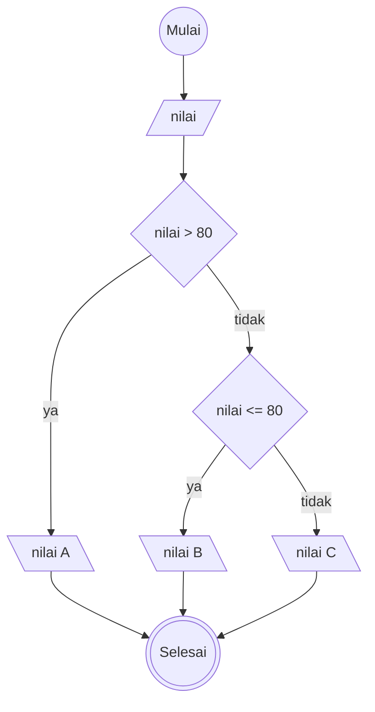

# Algoritma Implementasi

## Deskriptif

1. Mulai
2. Masukan nilai mahasiswa
3. jika nilai lebih dari 80 , maka nilai mahasiwa tersebut adalah A
4. jika nilai kurang atau sama dengan 80 ,maka nilai B dan kalo tidak maka nilai C
5. selesai

## flowchart

## Pseude Code

DECLARE nilai : INTEGER

IF nilai > 80 THEN
OUTPUT "A"
ELSE
IF nilai <= 80 THEN
OUTPUT "B"
ELSE
OUTPUT "C"
ENDIF
ENDIF
